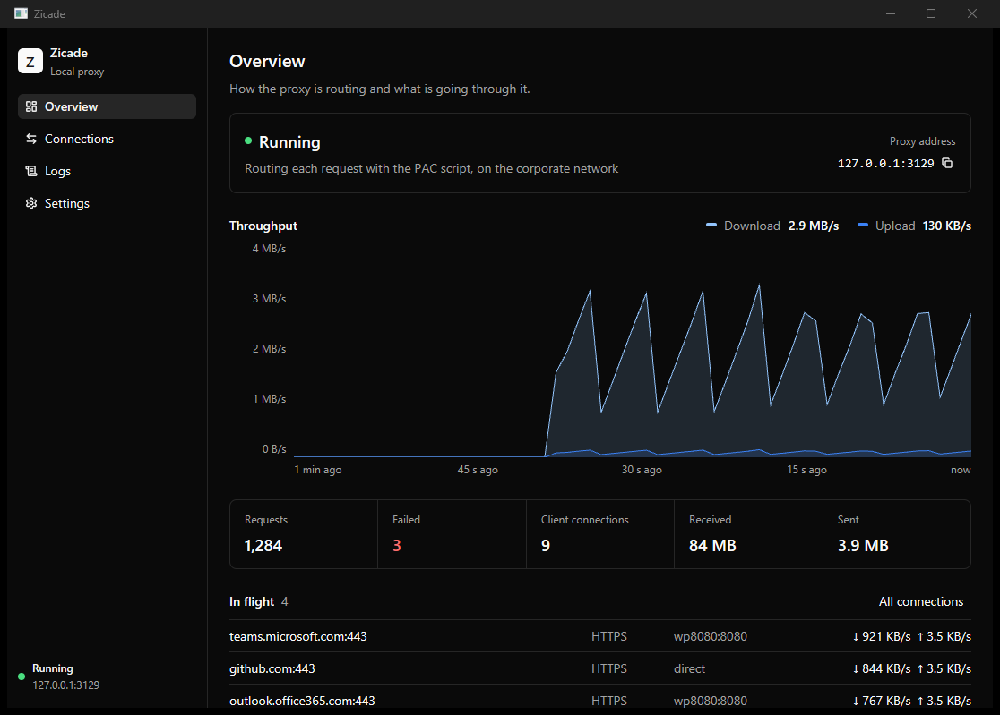
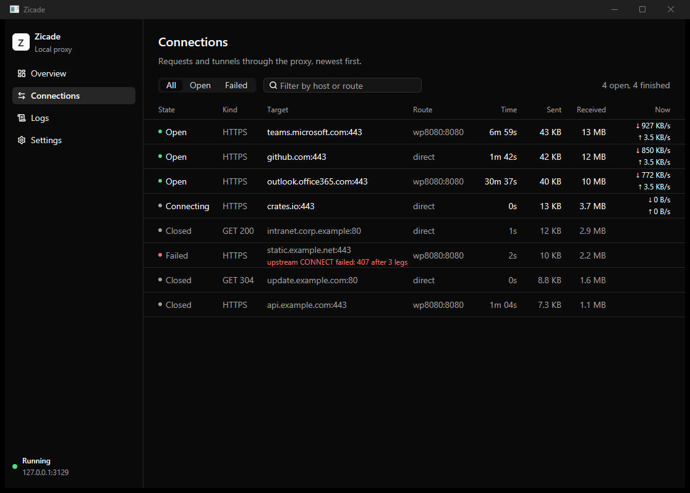
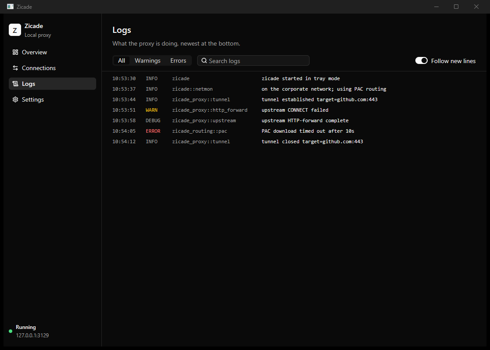
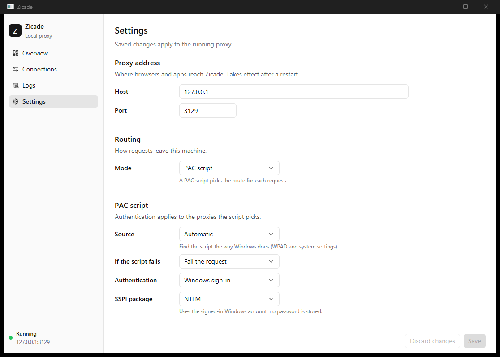

# Zicade

Zicade is a small, local forwarding **HTTP/HTTPS proxy** for Windows with a
native desktop window. It listens on `127.0.0.1`, forwards plain HTTP (absolute-form →
origin-form) and tunnels `CONNECT`, and can route either directly to origins or
through an upstream corporate proxy — including an SSPI **Negotiate** (Kerberos/
NTLM) handshake against that upstream. A native window (built with
[gpui-kit](https://gpui-kit.com)) edits the config, shows live status and
throughput, and follows the logs.



The workspace is a strict-TDD Cargo workspace:

| Crate | Responsibility |
| --- | --- |
| `zicade-config` | Config schema, load/save, validation |
| `zicade-routing` | PAC parsing + `RouteResolver` seam |
| `zicade-auth` | Upstream authenticator + Negotiate handshake state machine |
| `zicade-win` | The **only** crate with `unsafe`/FFI: SSPI, WinHTTP PAC, tray icon, network changes |
| `zicade-proxy` | The proxy data path (accept loop, forwarding, tunneling, connection tracking, shutdown) |
| `zicade-observe` | `tracing` layer → in-memory ring buffer + broadcast for the UI |
| `zicade-control` | The UI's handle on the running app: redacted config, live apply, status |
| `zicade-ui` | The native window (gpui-kit): overview, connections, logs, settings |
| `apps/zicade` | The binary: wires everything together and owns the lifecycle |

## Build prerequisites

- **Target toolchain:** `x86_64-pc-windows-gnu`
  (`rustup target add x86_64-pc-windows-gnu`). The build is pinned to this target
  via `.cargo/config.toml`.
- **w64devkit:** `C:\Users\<you>\tools\w64devkit\bin` provides the linker
  (`gcc` -> `collect2` -> `ld`) and `dlltool`; `.cargo/config.toml` wires them in.
- **Release builds of the UI** compile gpui's shaders with `fxc.exe` from the
  Windows SDK. CI (MSVC, with the SDK) has it; for a local release build install
  the SDK or point `GPUI_FXC_PATH` at an `fxc.exe`. Debug builds compile the
  shaders at runtime and need nothing extra.

- **crates.io reachability:** the initial dependency download must reach
  crates.io. On the corporate network this is the catch: **dependency downloads
  need an off-corp connection** (or a working proxy), while the **live proxy
  tests** below must run **on-corp** against the real upstream. Build/vendor deps
  off-corp first, then run the live suite on-corp.

## Releases

Releases are automated with [release-please]. Conventional-commit messages on
`main` (`feat:`, `fix:`, …) drive a rolling **release PR** that bumps the
workspace version (`Cargo.toml`, tracked via an `x-release-please-version`
annotation) and updates `CHANGELOG.md`. Merging that PR tags the commit, creates
the GitHub Release, and the pipeline builds the Windows `zicade.exe` and attaches
it to the release.

CI builds the release binary with the **MSVC** toolchain on `windows-latest`
(the pinned `x86_64-pc-windows-gnu` setup in `.cargo/config.toml` is a
developer-local convenience; the workflow overrides it). The app icon is
embedded either way — see [System-tray mode](#system-tray-mode-double-click).

[release-please]: https://github.com/googleapis/release-please

## Installing

Every release ships a setup installer (`zicade-<version>-setup.exe`) attached to
the GitHub Release, alongside the raw `.exe`. It targets Windows 10/11 (x64) and
is built in CI with [Inno Setup] 6.

Run it and follow the wizard.

### Install scope

The wizard first asks who to install for:

- **Install for me only** — installs under your profile
  (`%LOCALAPPDATA%\Programs\Zicade`), **no administrator rights and no UAC
  prompt**.
- **Install for all users** — installs to `Program Files\Zicade`. Choosing this
  triggers a **UAC elevation prompt** (only then).

### Startup options

A **Select Additional Tasks** page offers an off-by-default **Start on
sign-in** task: a `Run`-key entry (per-user `HKCU` or all-users `HKLM`, matching
the scope) that launches `zicade --background` at login: the
[tray](#system-tray-mode-double-click) without the window (a console window may
flash briefly before it self-hides).

Older versions could also register a Windows service. That mode is gone: an
all-users install stops and deletes a leftover `Zicade` service before copying
files, and the uninstaller removes one too.

The uninstaller (in *Add or remove programs*) removes the exe, Start-Menu
shortcut, and the `Run`-key entry.

### Silent install

Inno Setup supports unattended switches, e.g.:

```sh
# Just me + start in the tray on sign-in:
zicade-<version>-setup.exe /VERYSILENT /CURRENTUSER /TASKS="startonlogin"

# Uninstall silently:
"%LOCALAPPDATA%\Programs\Zicade\unins000.exe" /VERYSILENT
```

Developers can build the installer locally by opening
[`installer/zicade.iss`](installer/zicade.iss) in the Inno Setup IDE, or from a
shell after a release build:

```sh
iscc /DMyAppVersion=0.0.0 installer\zicade.iss
```

[Inno Setup]: https://jrsoftware.org/isinfo.php

## Running

```sh
cargo run -p zicade
```

On startup the binary:

1. Resolves the config path (first CLI argument, else the default below).
2. Loads the config, or writes the defaults on first run.
3. Installs the tracing subscriber (level/format from `logging`).
4. Binds the proxy on loopback, then serves until `Ctrl-C` (graceful shutdown
   drains in-flight connections).

Pass an explicit config path if you like:

```sh
cargo run -p zicade -- C:\path\to\config.json
```

### Address

**Proxy:** `config.listen` (default `127.0.0.1:3129`). Point your browser or
system proxy at it. Console mode has no window; edit the config file, or run in
the tray for the UI.

### Default config location

`%LOCALAPPDATA%\Zicade\config.json` (created with defaults on first run).

## System-tray mode (double-click)

When `zicade.exe` is launched with **no subcommand**, it chooses between console
and tray mode by how it was started:

- **Double-clicked in Explorer** — the process owns a freshly-created console
  (detected via `GetConsoleProcessList` returning `1`). Zicade **hides that
  console**, runs with a **system-tray (notification-area) icon**, and opens the
  [window](#the-window).
- **Run as `zicade` from an existing cmd/PowerShell** — the console is shared
  (process count `> 1`), so it stays in **console mode** as before.

`zicade --background` runs in the tray without opening the window (start on
sign-in uses it). Other explicit subcommands never enter tray mode: `zicade run`
and `zicade --help` keep their behavior regardless of how they were launched.

The tray icon's right-click menu has exactly two items:

- **Open Zicade**: opens the window, or brings it forward. A left-click on the
  icon does the same.
- **Close**: triggers the same graceful shutdown as Ctrl-C and exits.

Closing the window keeps the proxy running in the tray.

### Config schema (brief)

```jsonc
{
  "listen":  { "host": "127.0.0.1", "port": 3129 },
  "routing": {
    "mode": "direct",                 // "direct" | "upstream" | "pac"
    "upstream": {                      // required when mode = "upstream"
      "host": "wp8080", "port": 8080,
      "auth": {
        "mode": "negotiate",           // "none" | "basic" | "negotiate"
        "package": "ntlm",             // negotiate only: "ntlm" (default) | "negotiate"
        "username": null, "password": null   // username required when mode = "basic"
      }
    },
    "pac": {                           // required when mode = "pac"
      "source": "auto",                // "auto" | "file" | "url"
      "path": null, "url": null,
      "failPolicy": "error",           // "error" | "direct"
      "auth": { "mode": "negotiate" }  // inherited by PAC-selected upstreams
    },
    "corpNetwork": {                   // optional; gates pac/upstream on the corp network
      "enabled": true,
      "dnsSuffixes": ["droot.org"],    // required when enabled; matched dot-boundary, case-insensitive
      "pollSeconds": 30                // re-check fallback interval (default 30)
    }
  },
  "logging": { "level": "info", "format": "json" }
}
```

Validation runs at startup and **fails fast** with a clear message: ports must
be non-zero, `upstream`/`pac` sections are required for their modes, `basic` auth
requires a username, `negotiate` auth is only accepted on Windows, and an enabled
`corpNetwork` requires a non-empty `dnsSuffixes` and a non-zero `pollSeconds`.

#### Corporate-network detection (`routing.corpNetwork`)

Optional and **disabled by default** (absent = off; older configs are
unaffected). When enabled with `mode = "pac"` or `"upstream"`, a background
monitor decides whether the machine is on the corporate network by matching the
active adapters' connection-specific DNS suffixes against `dnsSuffixes`
(case-insensitive, on a dot boundary — `dy.droot.org` matches `droot.org`):

- **On the corporate network** → the configured routing (PAC/upstream) applies.
- **Off it** → the proxy routes **direct**, so it keeps working when you
  disconnect from corp instead of failing every request against an unreachable
  gateway/PAC.

Detection is event-driven (it reacts to Windows address-change notifications)
with `pollSeconds` as a re-check fallback. The on-corp routing is rebuilt on each
reconnect, so `source = "auto"` re-reads the system PAC after you rejoin the
network (even if the app started off-corp). The status page shows the
current **on-corp** state, and routing swaps live with no restart. Off-Windows,
or if adapter enumeration fails, detection is unavailable and the configured
routing applies unchanged (the feature is purely additive). Enabling the gate
from the UI when it was off at startup requires a restart; changing suffixes or
toggling it while it is already running takes effect immediately.

## The window

A native window (gpui-kit; follows the system light/dark theme) with a
sidebar of four pages. Ctrl+1 to Ctrl+4 switch pages and Ctrl+S saves settings.

- **Overview** (Ctrl+1): whether the proxy is running and how it routes, in
  words ("Routing each request with the PAC script, on the corporate
  network"), the proxy address with a copy button, live in/out throughput with
  a 60-second chart, totals (requests, failures, client connections, bytes
  received and sent), and what is in flight right now. Requests count plain
  HTTP and `CONNECT` tunnels alike. Bytes are counted as they are relayed (each
  tunnel chunk and each HTTP body frame), so a long download moves the chart
  while it runs.
- **Connections** (Ctrl+2): every request and tunnel in flight, then the last
  200 finished ones, filterable (all, open, failed) and searchable by host or
  route: state (connecting, open, closed, or failed with the reason), kind
  (`HTTPS` tunnel or `GET 200`-style request), target, route (`direct` or the
  upstream proxy actually used, including the PAC script's choice), age, bytes
  each way, and the live rate of open connections.
- **Logs** (Ctrl+3): the live log stream, starting with the buffered backlog,
  filterable by level and text; following new lines can be switched off to
  read back.
- **Settings** (Ctrl+4): every config field (proxy address, routing mode,
  upstream and its auth, PAC script and its auth, corporate-network detection,
  logging), showing only the sections the routing mode uses. Save is enabled
  once something changed; it validates, writes the config file, and applies
  routing/auth edits to the running proxy without a restart (a proxy address
  change still needs a restart). Stored passwords are never shown: leave a
  password blank to keep the saved one.

| Connections | Logs | Settings |
| --- | --- | --- |
|  |  |  |

To look at the window with sample data and no running proxy (the screenshots
above come from it):

```sh
cargo run -p zicade-ui --example preview -- [overview|connections|logs|settings] [light|dark]
```

The window talks to the proxy in-process; nothing listens besides the proxy.
Configs from older versions with a `web` section still load; the section is
dropped on the next save.

## Testing

```sh
cargo test            # full workspace suite (deterministic, no network)
```

The default suite is hermetic: no real upstream network, ephemeral loopback
ports, fake origins/backends.

### Live proxy suite (gated, on-corp)

The live tests are gated behind an env var and are intended for the
domain-joined Windows machine, on the corporate network, pointing at the real
`wp8080` upstream + PAC:

```sh
ZICADE_LIVE_PROXY=1 cargo test
```

Run these only on-corp; off-target they are skipped. Verified green against the
real Skyhigh/McAfee Secure Web Gateway at `wp8080:8080`: the multi-leg
`407 -> NTLM -> 200` handshake, HTTPS via `CONNECT` through the gateway,
plain-HTTP forwarding, and a soak that holds a flat OS-handle count (no leak).

The live PAC check exercises the `source = "auto"` discovery path (per-user
AutoConfigURL -> WPAD -> static proxy). It is tolerant of hosts with nothing
configured (a common corporate setup that pushes routing via GPO): discovery
maps "no config" to DIRECT, so it logs the real decision rather than failing.

## Known limitations

- **PAC data-path routing is wired.** In `mode = "pac"` the proxy resolves each
  request through WinHTTP and connects DIRECT or through the resolved upstream
  (applying `routing.pac.auth`, LESSON-6). `source = "auto"` discovers the
  effective proxy configuration the way Windows and browsers do: it reads the
  per-user WinINET/IE settings and applies MSDN precedence — the "Use setup
  script" address (`AutoConfigURL`, a PAC URL) first, then WPAD network
  auto-detect, then a static manual proxy (honouring its bypass list: `<local>`,
  exact and `*`-wildcard hosts), and finally DIRECT when nothing is configured.
  This means a PAC configured only under `HKCU\...\Internet Settings\
  AutoConfigURL` is now honoured (previously `auto` did WPAD auto-detect only and
  failed with `ERROR_WINHTTP_UNABLE_TO_DOWNLOAD_SCRIPT` on hosts with no WPAD
  server). `source = "url"` (or `"file"`) still points at a PAC explicitly.
  `failPolicy` governs resolution
  failures: `"direct"` falls back to a DIRECT connection, `"error"` fails the
  request with `502`. PAC results are not cached (each request re-resolves).
- **Upstream connections are authenticated per request, not pooled.** Because
  Negotiate/NTLM authenticates the TCP connection (not the request), each
  HTTP-forward request opens a fresh upstream connection, completes the multi-leg
  407 handshake, and tears it down. This is an intentional, correct, leak-free
  design (LESSON-7): the per-request connect/auth/teardown holds a flat OS-handle
  steady state, locked in by regression tests. Reusing an authenticated upstream
  connection across requests on the same client keep-alive connection would save
  the handshake cost, but is **deliberately deferred** — it adds per-connection
  stream state, mid-reuse reconnect/re-auth, and keep-alive framing complexity
  with real risk to the handle-stability guarantee, for a latency win that does
  not justify it. `CONNECT` tunnels are inherently per-connection and unaffected.
- **`negotiate` is Windows-only.** Off-Windows, config validation rejects it; if
  a Negotiate authenticator is somehow constructed off-target, it errors at
  handshake time rather than at startup.
- **`negotiate` defaults to the NTLM SSPI package, not SPNEGO/Kerberos.** The
  target corporate gateway (Skyhigh/McAfee) offers `Negotiate`/`NTLM`/`Basic` but
  does not accept SPNEGO, and has no Kerberos SPN for the proxy appliance. The
  SSPI `Negotiate` package's raw-NTLM fallback also cannot complete against it
  (`SEC_E_INVALID_TOKEN` on the challenge leg). So the SSPI package defaults to
  **NTLM**, which completes the standard three-leg handshake; the gateway accepts
  the token under the `Negotiate` scheme. Environments with a Kerberos SPN can
  opt into Kerberos SSO by setting `auth.package = "negotiate"` (see config).

## Upstream authentication

`auth.mode` selects how Zicade authenticates to the upstream proxy:

- `none` — no proxy authentication.
- `basic` — sends `Proxy-Authorization: Basic base64(user:pass)` preemptively;
  requires a non-empty `auth.username` (validated at startup). A `407` after the
  credential was sent fails cleanly (no retry loop).
- `negotiate` — Windows SSPI. `auth.package` picks the security package:
  `"ntlm"` (default, required by the target gateway) or `"negotiate"`
  (SPNEGO/Kerberos, for gateways with a registered SPN).
